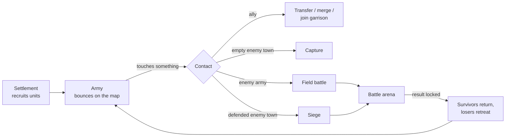

# Stick Legions — architecture overview

Stick Legions is a top-down 2D auto battler in Unity (C#). Armies roam a world map on their own, and when enemies meet, the game cuts to a battle in which every unit fights without player input. This page is a short summary; the full rule-by-rule contract starts at [00-Core.md](00-Core.md).

A battle runs in its own arena while the map is frozen. Units walk in from their side's edge and fight autonomously until one side is gone or time runs out. Survivors keep their HP, XP and level.

## Systems

| System | What it does | Map file |
| --- | --- | --- |
| Movement | Target search, momentum, flanking "Sidestep" | [01](01-Movement-Sidestep.md) |
| Clash | Resolves two units meeting: damage, knockback, Dodge | [02](02-Clash-Transaction.md) |
| Health, death, XP | One damage path for every source; kills level units up | [03](03-Health-Death-XP.md) |
| Modifiers | Timed buffs, debuffs and damage over time | [04](04-Stats-Modifiers.md) |
| Abilities | Projectile, Area and Self Buff casts | [05](05-Abilities-Triggered-Casts.md) |
| UI | Health bar and level badge | [06](06-UI.md) |
| World map and battles | Armies, settlements, battle start, end, retreat, sieges | [07](07-WorldMap-Battle.md) |

## Design rules

- **One owner per unit.** That owner is an army, a garrison or a pending-retreat roster. Only `UnitReserve2D` changes it, and an audit after each battle catches lost units.
- **Units sleep until needed.** Recruited units stay inactive and never run `Awake` before their first battle.
- **Clashes are fair.** Both units are measured before either result applies, so collision order doesn't matter.
- **A decided result is final.** After the lock, nothing in that battle can deal damage, clash or cast.
- **Side is physics, not faction.** Layers and enemy masks are rebound every time a unit deploys.

## Reading the full map

Start with [00-Core.md](00-Core.md): ownership, file inventory, update order and glossary. Each rule has a stable ID (for example `CLASH-08`) defined in one place. Tags such as `[WM5]` say whether a Unity test confirmed the rule; they are explained in [90-Evidence.md](90-Evidence.md). History is in [91-ChangeLog.md](91-ChangeLog.md) and test results are in [92-Validation.md](92-Validation.md).
